# DevLand Enterprise — Phase 1, Part 2: Database design & ERD

Covers deliverables 4, 5 (schema file: `packages/db/prisma/schema.prisma`), 6.

> The schema was written carefully but **not run through `prisma validate` in my environment** (no network/CLI there). First action in Phase 2: `pnpm prisma validate && pnpm prisma format`, then fix anything it flags.

## 1. Design principles

1. **PostgreSQL is the source of truth.** Discord messages, Redis jobs and caches are projections.
2. **Snapshots over joins for history.** Order line items store label + price snapshots; orders copy exchange rate, commission percent and policy version. Editing the store, rates or commissions never rewrites past orders (spec §10, §13, §41).
3. **Append-only where money or accountability is involved:** `OrderStatusHistory`, `DeveloperLedgerEntry`, `WalletTransaction`, `ExchangeRate`, `AuditEvent`, `Delivery` versions. Balances are `SUM`s, never mutable counters.
4. **Idempotency is a column, not a hope:** `Payment.idempotencyKey`, `Refund.idempotencyKey`, `WalletTransaction.idempotencyKey`, `DeveloperLedgerEntry.idempotencyKey` (e.g. `earning:<orderId>`), `OutboxEvent.idempotencyKey`, `InboxEvent(consumer,eventId)`.
5. **Optimistic locking:** `version` on mutable aggregates; updates use `WHERE id=? AND version=?`.
6. **Soft delete** (`deletedAt`) on User, Developer, Service, Feature, Order. Never on ledgers/history/audit.
7. **Money:** `Decimal(14,2)` with an explicit `currency` on every row. Arithmetic uses a Decimal library in a single `Money` value object; no floats anywhere.
8. **Actor columns are soft references** (`actorType` + plain uuid) on history/ledger rows, because actors may be SYSTEM, API keys, AI or workflows. Business relationships are real foreign keys.
9. **Human-readable IDs** come from `Sequence` (atomic `UPDATE … RETURNING` inside the creating transaction). Stored as `number`; formatted by one function:

| Entity | Discord | Dashboard |
|---|---|---|
| Order | `DL-1042` | `DL-ORD-2026-1042` |
| Ticket (order) | `DL-T-1042` | `DL-TKT-2026-1042` |
| Ticket (support, own sequence) | `DL-S-0087` | `DL-SUP-2026-0087` |
| Invoice (own sequence, stored string) | — | `DL-INV-2026-000123` |

The year comes from `createdYear` / `createdAt`; the number does not reset yearly, so `number` stays unique.

## 2. ERD (core, MVP-critical relations)

```mermaid
erDiagram
  User ||--o| CustomerProfile : has
  User ||--o| DeveloperProfile : is
  User ||--o{ Session : logs_in
  User ||--o| TwoFactorCredential : secures
  User ||--o{ AccessGrant : receives
  AccessRole ||--o{ AccessRolePermission : grants
  Permission ||--o{ AccessRolePermission : in
  AccessRole ||--o{ AccessGrant : via

  Service ||--o{ ServiceQuestion : asks
  Service ||--o{ FeatureGroup : groups
  Service ||--o{ ServiceFeature : offers
  FeatureGroup ||--o{ ServiceFeature : contains
  ServiceFeature ||--o{ FeatureDependency : requires
  ServiceFeature ||--o{ FeatureIncompatibility : conflicts
  Service ||--o{ DeveloperPoolMembership : pool
  DeveloperProfile ||--o{ DeveloperPoolMembership : joins
  CommissionRule }o--o| Service : scoped_to
  CommissionRule }o--o| DeveloperProfile : scoped_to

  User ||--o{ Order : places
  Service ||--o{ Order : of
  DeveloperProfile |o--o{ Order : assigned
  ExchangeRate ||--o{ Order : snapshot_of
  Order ||--o| Ticket : workspace
  Order ||--|{ OrderItem : lines
  Order ||--|{ OrderStatusHistory : transitions
  Order ||--o{ OrderAssignment : assignments
  Order ||--o{ DeveloperRequest : requests
  Order ||--o{ DeadlineProposal : proposals
  Order ||--o{ DeadlineExtension : extensions
  Order ||--o{ Delivery : versions
  Delivery ||--o{ DeliveryFile : files
  Delivery ||--o{ ChangeRequest : triggers
  Order ||--o{ Payment : payments
  PaymentMethod ||--o{ Payment : used_by
  Payment ||--o{ PaymentProof : proofs
  Payment ||--o{ Refund : refunded_by
  Order ||--o| Invoice : invoiced
  Order ||--o| Review : reviewed
  Order ||--o{ PolicyAcceptance : accepted
  PolicyVersion ||--o{ PolicyAcceptance : of
  Policy ||--o{ PolicyVersion : versions

  DeveloperProfile ||--o{ DeveloperLedgerEntry : earns
  DeveloperProfile ||--o{ WithdrawalRequest : requests
  User ||--o{ Wallet : owns
  Wallet ||--o{ WalletTransaction : ledger

  FileObject ||--o| PaymentProof : bytes_of
  FileObject ||--o| DeliveryFile : bytes_of
  FileObject ||--o| OrderAttachment : bytes_of
  Order ||--o{ OrderAttachment : attachments
```



Platform tables with no business FKs (by design): `AuditEvent`, `AuditCheckpoint`, `OutboxEvent`, `InboxEvent`, `DeadLetterEvent`, `IdempotencyRecord`, `Setting`, `FeatureFlag`, `Sequence`, `ApprovalRequest/Decision`, `Notification`. They reference business rows by `(type, id)` strings so audit/event history survives archival of the rows they describe.

## 3. ERD explanation (the relationships that matter)

**Identity.** One `User` per Discord account (`discordId` unique). A user may also have a `CustomerProfile` (level, aggregates) and/or a `DeveloperProfile`. Developer financial data hangs off `DeveloperProfile` only (ledger, withdrawals) so the "financial data must be private" rule maps to table-level permissions.

**Access.** Discord roles are *mapped*, never created: `AccessRole.discordRoleId` is set by the Owner in the dashboard. On every request/interaction the member's Discord role IDs are resolved to `AccessRole`s → `AccessRolePermission` (with optional ABAC `conditions`). `AccessGrant` handles per-user overrides, temporary/JIT/delegated access with mandatory `reason` and `expiresAt`. `Permission.isSensitive` marks keys that need step-up 2FA and/or approval.

**Store.** `Service` → `ServiceQuestion` (service-specific intake), `FeatureGroup` (min/max selections), `ServiceFeature` (feature/add-on/option with price and currency). Dependencies and incompatibilities are explicit edge tables, so the pricing engine validates a selection as a graph check. `DeveloperPoolMembership` = the service-specific developer pool (spec §12).

**Orders and tickets.** `Ticket` is the Discord workspace; `Order` is the business record; they are 1:1 for ORDER tickets (`Ticket.orderId` unique). An order's lifecycle is the `OrderStatus` enum with every transition in `OrderStatusHistory` (actor, timestamp, from, to, reason, correlationId). "Unassigned" is not a status: it is `assignedDeveloperId IS NULL`, which keeps the payment/work status machine clean and lets claim-reminder logic query it directly. `OrderAssignment` keeps assignment history (claim, owner-assigned, requested-developer approved); `DeveloperRequest` handles "customer asks for a specific developer" → Owner approval.

**Pricing snapshot.** `OrderItem` rows (base, features, add-ons, discounts) with label snapshots; `Order.subtotal/discountTotal/total`, `exchangeRateId` + copied `exchangeRateValue`. `ExchangeRate` is append-only; changing the rate inserts a row and writes an audit event.

**Commission.** `CommissionRule` rows with scope (`DEFAULT`, `SERVICE`, `DEVELOPER`, `DEVELOPER_SERVICE`). Resolution: most specific wins (`DEVELOPER_SERVICE` > `DEVELOPER` > `SERVICE` > `DEFAULT`), which preserves the spec's "developer-specific → service-specific → default". Resolved percent, DevLand amount and developer amount are copied onto the order **at assignment** and are recomputed only through an audited adjustment.

**Deadlines.** `DeadlineProposal` (unique per `(orderId, round)`; policy: developer gets round 1 only, further rounds need Owner permission) → customer accepts/rejects/asks for another. `Order.deadlineAt` and `deadlineApprovedAt` are set only on acceptance (or Owner decision); the timer job is scheduled from `deadlineApprovedAt`. `DeadlineExtension` is the only way an approved deadline moves, and requires Owner permission.

**Delivery & changes.** `Delivery` is versioned per order (`@@unique([orderId, version])`), with `DeliveryFile`s pointing at `FileObject`. Rejecting a delivery creates a `ChangeRequest` (`number` per order) and increments `Order.changeRequestsUsed`; limit resolution is order override → service override → global setting.

**Payments.** `PaymentMethod` (provider, encrypted account fields, instructions per locale, currency, enabled) → `Payment` (state machine) → `PaymentProof` (file + SHA-256 for duplicate-proof detection). Proof visibility is a permission, not a column: only `payment.proof.view` holders and the paying customer; developers see only `Order.paymentStatus`.

**Finance.** `DeveloperLedgerEntry` is the developer's balance (credit on order completion with idempotency key `earning:<orderId>`; debit on paid withdrawal). `WithdrawalRequest` follows PENDING → APPROVED → PAID | REJECTED. `Wallet`/`WalletTransaction`/`Refund` are in the schema now so the ledger design is fixed before anything depends on it; services come later.

**Policies.** `PolicyAcceptance` ties an order to an exact `PolicyVersion` + content hash. New policy versions only affect future orders.

**Files.** `FileObject` is storage-agnostic metadata (provider, key, sha256, classification, encryption key id). Three domain tables point at it; none embeds bytes.

**Audit & events.** `AuditEvent` is a per-chain hash chain (`prevHash`, `hash`, gapless `sequence`). `OutboxEvent` is written in the business transaction; `InboxEvent` makes consumers idempotent; `DeadLetterEvent` captures exhausted retries for management in the dashboard.

## 4. Constraints Prisma cannot express (raw SQL migrations in `packages/db/prisma/sql/`)

```sql
-- Exactly one approved payment per order (prevents duplicate payments)
CREATE UNIQUE INDEX uq_payment_one_approved_per_order
  ON "Payment"("orderId") WHERE status = 'APPROVED';

-- One current assignment per order
CREATE UNIQUE INDEX uq_assignment_one_active_per_order
  ON "OrderAssignment"("orderId") WHERE "unassignedAt" IS NULL;

-- One open support ticket per customer
CREATE UNIQUE INDEX uq_support_one_open_per_customer
  ON "Ticket"("customerId") WHERE kind = 'SUPPORT' AND status = 'OPEN';

-- One pending developer request per order+developer
CREATE UNIQUE INDEX uq_devrequest_pending
  ON "DeveloperRequest"("orderId","developerId") WHERE status = 'PENDING';

-- One accepted delivery per order (duplicate delivery acceptance guard)
CREATE UNIQUE INDEX uq_delivery_one_accepted
  ON "Delivery"("orderId") WHERE status = 'ACCEPTED';

-- Money sanity
ALTER TABLE "Order" ADD CONSTRAINT ck_order_total CHECK (total >= 0 AND subtotal >= 0 AND discountTotal >= 0);
ALTER TABLE "AccessGrant" ADD CONSTRAINT ck_grant_expiry
  CHECK (kind IN ('PERMANENT','DELEGATED') OR "expiresAt" IS NOT NULL);
ALTER TABLE "Review" ADD CONSTRAINT ck_review_ratings
  CHECK ("devlandRating" BETWEEN 1 AND 5 AND "developerRating" BETWEEN 1 AND 5
     AND "workQuality" BETWEEN 1 AND 5 AND "deliverySpeed" BETWEEN 1 AND 5 AND communication BETWEEN 1 AND 5);

-- Append-only enforcement (defense in depth; see doc 03 §6)
CREATE FUNCTION forbid_mutation() RETURNS trigger AS $$
BEGIN RAISE EXCEPTION '% is append-only', TG_TABLE_NAME; END; $$ LANGUAGE plpgsql;
CREATE TRIGGER audit_no_update BEFORE UPDATE OR DELETE ON "AuditEvent"
  FOR EACH ROW EXECUTE FUNCTION forbid_mutation();
-- same trigger on OrderStatusHistory, DeveloperLedgerEntry, WalletTransaction, ExchangeRate, AuditCheckpoint
-- And, when the host allows separate DB roles:
-- REVOKE UPDATE, DELETE, TRUNCATE ON "AuditEvent" FROM devland_app;
```
(Column casing in the real files must match Prisma's generated names; Phase 2 verifies these against a migrated DB.)

## 5. Indexing & performance notes
Composite indexes are declared for the hot paths: `Order(customerId,status)`, `Order(assignedDeveloperId,status)`, `Order(serviceId,status,assignedDeveloperId)` (unclaimed-order scan), `Order(deadlineAt)`, `OutboxEvent(status,availableAt)` (relay poll), `Notification(status,scheduledFor)`, `AuditEvent(targetType,targetId,occurredAt)`. Full-text/fuzzy search (spec §62) is a later phase using `pg_trgm` + `tsvector` indexes added by migration; nothing in the schema blocks it.

## 6. What is intentionally *not* in the Phase 1 schema (and why that is safe)

These domains are in your spec but are not needed to take real orders. Their tables are added by additive migrations in their phase, referencing existing rows by id; no existing table needs to change. Hooks already present are noted.

| Domain | Hook already in schema |
|---|---|
| Promotions, promo codes, loyalty, referrals, gift cards | `OrderItem(kind=DISCOUNT)`, `Order.discountTotal`, `CustomerLevel`, `WalletTxType` |
| Support tickets & SLA | `Ticket.kind=SUPPORT`, `category`, `priority`, `slaDueAt`, `convertedOrderId` |
| Contracts, disputes | `Order` id as anchor; `Sequence` for numbering |
| Anti-fraud, abuse cases, incidents, threat detection | `SecurityEvent`, `PaymentProof.sha256`, `CustomerProfile.riskScore`, `Session.riskScore` |
| Workflows, API platform, API keys, integrations | event catalog + `OutboxEvent` are the trigger source |
| KB, AI, feedback/NPS | `Ticket` ids, `Review` |
| Applications, suggestions, giveaways, announcements, moderation, welcome, autorole | independent of order flow |
| Analytics/reporting | read models built from events + ledgers |
| Backups, maintenance, releases, status | operational tables only |
