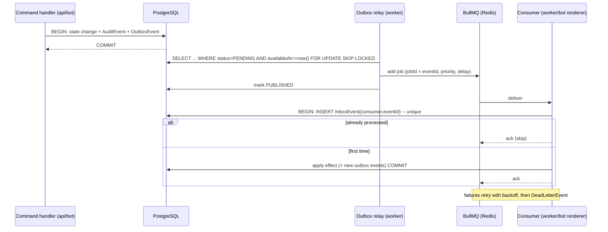

# DevLand Enterprise — Phase 1, Part 4: Event bus, event catalog, queues & workers

Covers deliverables 8, 9, 14.

## 1. Event bus architecture

**Pattern: transactional outbox + BullMQ + idempotent inbox.** This is the strongest real guarantee available on Postgres + Redis: *at-least-once delivery, effectively-once processing*. It does not claim exactly-once.



Key properties:
- **No dual-write problem:** business-critical events are persisted atomically with the state change. If Redis is down, events wait in `OutboxEvent`; nothing is lost.
- **Dedup:** BullMQ `jobId = eventId` (queue-level) + `InboxEvent` unique `(consumer,eventId)` (consumer-level) + `OutboxEvent.idempotencyKey` (producer-level, e.g. `payment.approved:<paymentId>`).
- **Ordering:** per-aggregate ordering via `partitionKey` (= aggregate id). The relay publishes events of one partition sequentially (ordered by `occurredAt,id`); consumers of order-sensitive events use per-partition concurrency 1 (BullMQ groups, or a named-lock around handler). Cross-aggregate ordering is not guaranteed and not needed.
- **Delayed events:** `availableAt` in the future (e.g. "claim reminder in 15 min"). The outbox is the durable schedule; BullMQ delay is only an optimization.
- **Priority:** `priority` 1 (payments/security) … 10 (analytics).
- **Replay:** `pnpm events:replay --type X --from T --consumer Y` re-enqueues outbox rows; safe because consumers are idempotent (`--force` clears matching `InboxEvent` rows for a consumer, audited).
- **Dead letters:** after max attempts (default 8, exponential backoff + jitter) → `DeadLetterEvent`, Discord alert to Owner, dashboard page to retry/resolve/discard (audited).
- **Tracing:** every event carries `correlationId` (whole user action) and `causationId` (the event that caused this one). Logs and audit rows share them.
- **Schema registry:** `packages/contracts/events/<event>/v<N>.ts` (zod). Rules: additive changes stay in the same version; breaking change = new `vN+1` with both versions emitted/consumed during migration; CI check compares schemas against the previous release and fails on unversioned breaking changes. `pnpm events:docs` generates the catalog.

### Envelope (all events)
```ts
const EventEnvelope = z.object({
  id: z.string().uuid(),               // eventId
  type: z.string(),                    // 'order.created'
  schemaVersion: z.number().int(),
  occurredAt: z.string().datetime(),
  aggregate: z.object({ type: z.string(), id: z.string() }),
  partitionKey: z.string(),
  correlationId: z.string(),
  causationId: z.string().nullable(),
  actor: z.object({ type: z.enum(['USER','SYSTEM','API_KEY','AI','WORKFLOW']), id: z.string().nullable() }),
  payload: z.unknown(),                // validated per-type schema
});
```
**Payloads carry ids and the minimum facts consumers need, never secrets, proofs, or PII beyond what Discord rendering requires.** Consumers re-read current state from the DB when they need more.

## 2. Event catalog (MVP) and schemas

Naming: `<domain>.<entity>.<past-tense-verb>` is relaxed to `<domain>.<verb>` where unambiguous. All events are v1.

### Orders & tickets
| Event | Payload (v1) | Key consumers |
|---|---|---|
| `order.created` | `{orderId, number, customerId, serviceId, currency, total, itemCount}` | tickets (create channel), notifications, claim-timer scheduler |
| `order.status_changed` | `{orderId, from, to, reason?}` | discord renderer, notifications, analytics |
| `order.claimed` | `{orderId, developerId, method, devlandPercent}` | notifications, claim-timer cancel, ticket permissions |
| `order.unclaimed_reminder_due` | `{orderId, attempt}` | notifications (ping eligible pool) |
| `order.assigned` | `{orderId, developerId, byActor}` | same as `claimed` (Owner assignment path) |
| `order.developer_requested` | `{orderId, developerId}` | notifications (Owner) |
| `order.developer_request_decided` | `{orderId, developerId, decision}` | notifications |
| `order.queue_joined` / `order.queue_promoted` | `{queueEntryId, serviceId, customerId, position?}` | notifications, ticket |
| `order.cancelled` | `{orderId, reason}` | tickets, payments (void pending), notifications |
| `order.completed` | `{orderId, developerId, devlandAmount, developerAmount, currency}` | **developers (credit ledger)**, reviews (open review window), invoices |
| `ticket.opened` / `ticket.closed` | `{ticketId, kind, orderId?, customerId}` | discord renderer |

### Payments
| Event | Payload | Consumers |
|---|---|---|
| `payment.method_selected` | `{paymentId, orderId, methodId}` | discord renderer (instructions) |
| `payment.proof_submitted` | `{paymentId, orderId, proofId}` | notifications (Owner review queue); **no file ref in payload** |
| `payment.approved` | `{paymentId, orderId, amount, currency}` | orders (→ PAID), invoices, notifications, analytics |
| `payment.rejected` | `{paymentId, orderId, reason}` | orders (→ AWAITING_PAYMENT), notifications |
| `invoice.issued` / `invoice.voided` | `{invoiceId, number, orderId}` | notifications, storage (PDF later) |

### Deadlines, delivery, reviews
| Event | Payload | Consumers |
|---|---|---|
| `deadline.proposed` | `{orderId, proposalId, proposedDeadline}` | notifications (customer) |
| `deadline.accepted` / `deadline.rejected` / `deadline.another_requested` | `{orderId, proposalId}` | orders, timer scheduler, notifications |
| `deadline.owner_set` / `deadline.extended` | `{orderId, previous?, new, reason}` | timer scheduler, notifications |
| `deadline.warning_due` / `deadline.breached` | `{orderId, deadlineAt}` | notifications, analytics (on-time rate) |
| `delivery.submitted` | `{orderId, deliveryId, version}` | orders (→ WAITING_FOR_CLIENT), notifications |
| `delivery.accepted` | `{orderId, deliveryId}` | orders (→ COMPLETED → REVIEW) |
| `delivery.changes_requested` | `{orderId, deliveryId, changeRequestId, number, remaining}` | orders (→ IN_PROGRESS), notifications |
| `change_request.limit_reached` | `{orderId}` | notifications (Owner decides override) |
| `review.submitted` | `{reviewId, orderId, developerId}` | developers (stats recompute), analytics |

### Developers & finance
| Event | Payload | Consumers |
|---|---|---|
| `developer.balance_credited` | `{developerId, orderId, amount, currency, ledgerEntryId}` | notifications (dev) |
| `withdrawal.requested/approved/paid/rejected` | `{withdrawalId, developerId, amount, currency}` | notifications, ledger (debit on paid) |
| `developer.pool_changed`, `developer.commission_changed` | `{developerId, ...}` | access cache invalidation |

### Platform
| Event | Payload | Consumers |
|---|---|---|
| `setup.completed` | `{guildId, created[], reused[]}` | audit/notifications |
| `config.setting_changed` | `{namespace, key}` | caches |
| `exchange_rate.changed` | `{rateId, base, quote, rate}` | caches, notifications |
| `access.grant_created/expired/revoked`, `access.role_mapping_changed` | `{...}` | authorization cache |
| `approval.requested/decided` | `{approvalId, action}` | notifications |
| `auth.login_succeeded/failed`, `auth.session_revoked` | `{userId, sessionId?}` | security monitor |
| `security.event_recorded` | `{securityEventId, type, severity}` | notifications (Owner if ≥HIGH) |
| `audit.integrity_violation_detected` | `{chainId, firstBrokenSequence}` | notifications (Owner, urgent), incidents later |
| `system.lockdown_activated/deactivated` | `{by, reason}` | everything that must freeze |

### Example schemas
```ts
// packages/contracts/events/order.created/v1.ts
export const OrderCreatedV1 = z.object({
  orderId: z.string().uuid(),
  number: z.number().int().positive(),
  customerId: z.string().uuid(),
  serviceId: z.string().uuid(),
  currency: z.enum(['EGP','USD']),
  total: z.string().regex(/^\d+(\.\d{1,2})?$/),   // decimal as string, never float
  itemCount: z.number().int().nonnegative(),
});

// packages/contracts/events/order.completed/v1.ts
export const OrderCompletedV1 = z.object({
  orderId: z.string().uuid(),
  developerId: z.string().uuid(),
  devlandAmount: z.string(), developerAmount: z.string(),
  currency: z.enum(['EGP','USD']),
});

// packages/contracts/events/payment.approved/v1.ts
export const PaymentApprovedV1 = z.object({
  paymentId: z.string().uuid(), orderId: z.string().uuid(),
  amount: z.string(), currency: z.enum(['EGP','USD']),
});
```

## 3. Queue & worker architecture (deliverable 14)

All queues are BullMQ on Redis (`noeviction`). Redis is a transport and timer optimization; **Postgres can reconstruct every timer** (§4).

| Queue | Purpose | Concurrency | Retry | Notes |
|---|---|---|---|---|
| `outbox-relay` | Poll outbox, publish to queues | 1 leader (advisory lock) | n/a | Polls every ~500 ms; `FOR UPDATE SKIP LOCKED` batches |
| `events.orders` | Order-domain consumers (timers, queue promotion) | per-partition 1 | 8, exp. backoff | |
| `events.payments` | Payment consumers | per-partition 1 | 8 | Priority high |
| `events.finance` | Ledger credit, withdrawals | per-partition 1 | 8 | Idempotency key `earning:<orderId>` |
| `discord-outbound` | All Discord REST writes (messages, channel perms, DMs) | rate-limit aware (discord.js REST queue + global limiter) | 5, honors 429 `retry_after` | Bot consumes; DM-closed errors → `Notification.status=FAILED` w/ fallback to ticket channel |
| `notifications` | Dedupe/group/quiet-hours, then hand to `discord-outbound` | 10 | 5 | `Notification.dedupeKey` |
| `timers` | Claim reminders, deadline warnings/breach, grant expiry | 5 | 5 | Delayed jobs, keyed by `timer:<kind>:<id>` for idempotent re-adds |
| `queue-promotion` | Promote waiting customers when capacity frees | per-service 1 | 5 | Triggered by `order.completed/cancelled` |
| `audit-chain` | Checkpoint signer | 1 | 5 | Every N min |
| `audit-verify` | Integrity verification | 1 | 2 | Daily + on demand |
| `files-maintenance` | Orphaned upload cleanup, integrity re-checks | 2 | 3 | |
| `invoices-pdf` | PDF generation (later) | 2 | 3 | Isolated: CPU/memory heavy |
| `dlq` | Dead letter intake | 2 | — | Writes `DeadLetterEvent`, alerts |

**Worker topology:** one `apps/worker` image started with `WORKER_QUEUES=events.orders,timers,...` so heavy queues (`invoices-pdf`, later AI/backups) can run on separate processes/hosts without code changes.

**Graceful shutdown:** SIGTERM → stop fetching, finish in-flight jobs (timeout), release locks; bot finishes in-flight interaction acks.

**Backpressure/circuit breakers:** `discord-outbound` pauses on sustained 5xx/429 storms and resumes by probe; each external dependency (Discord, storage provider, Redis, DB) has a health indicator surfaced to the Owner via `doctor`/health endpoint now, and automated remediation/self-healing rules in a later phase (spec §54).

## 4. Reconcilers (why Redis loss is survivable)

Run on worker start and every few minutes; all are idempotent and audited when they repair something:

| Reconciler | Query (source of truth) | Repair |
|---|---|---|
| Outbox | `OutboxEvent PENDING/FAILED` older than threshold | republish |
| Claim reminders | `Order WHERE assignedDeveloperId IS NULL AND status IN (PAID,…)` vs `claimRemindersSent`, `lastClaimReminderAt` | re-add missing timer |
| Deadlines | `Order WHERE deadlineApprovedAt IS NOT NULL AND status IN (IN_PROGRESS,WAITING_FOR_CLIENT)` | re-add warning/breach timers |
| Queue promotion | capacity vs `QueueEntry WAITING` | promote |
| Discord panels | `DiscordPanel` vs live messages | re-post/edit drifted panels |
| Discord tickets | `Ticket.discordChannelId` vs existing channels | flag + Owner alert (never silently recreate customer channels) |
| Grants/sessions | expired `AccessGrant`, past-idle `Session` | mark expired/revoked |

## 5. Claim-reminder behaviour (spec §14)
Settings (`Setting` namespace `claim`): `firstReminderMinutes=15`, `repeat=false`, `repeatIntervalMinutes=30`, `maxReminders=3`. Flow: `order.created`→(payment approved)→order becomes claimable → timer `timer:claim:<orderId>` at `+15 min` → on fire: if still `assignedDeveloperId IS NULL` → emit `order.unclaimed_reminder_due` → notifications pings the service pool role/members, increments `claimRemindersSent`, schedules the next if `repeat && count<max`. `order.claimed` cancels pending timers; a late-firing timer re-checks state first (idempotent no-op).

*Design note:* orders become claimable after payment approval (PAID), since developers shouldn't start unpaid work. Tell me if you want pre-payment visibility in the pool instead.

## 6. Order state machine (referenced by permissions in doc 03)

| From | To | Trigger | Who (permission) | Side effects |
|---|---|---|---|---|
| (new) | AWAITING_PAYMENT | order created | customer (`order.create`) | ticket channel, payment instructions |
| AWAITING_PAYMENT | PAYMENT_REVIEW | proof submitted | customer | Owner review notification |
| PAYMENT_REVIEW | PAID | payment approved | `payment.review` | invoice, claimable, pool notified |
| PAYMENT_REVIEW | AWAITING_PAYMENT | payment rejected | `payment.review` | customer told reason |
| PAID | IN_PROGRESS | developer claims (or Owner assigns) | `order.claim` / `order.assign` | commission snapshot, ticket perms, deadline proposal enabled |
| IN_PROGRESS | WAITING_FOR_CLIENT | delivery submitted / developer needs info | `delivery.submit` | customer notified |
| WAITING_FOR_CLIENT | IN_PROGRESS | changes requested / client replied | customer | change counter++ |
| WAITING_FOR_CLIENT | COMPLETED | delivery accepted | customer (`delivery.respond`) | developer ledger credited, queue promotion |
| COMPLETED | REVIEW | automatic | system | review prompt (DM + ticket) |
| any pre-COMPLETED | CANCELLED | cancel | `order.transition.cancel` (sensitive) | payments voided / refund flow (manual), ledger untouched |

Implemented as a pure transition table in `packages/core/modules/orders/domain/order.state.ts`; illegal transitions throw `IllegalTransitionError` and are impossible to reach from handlers because only `OrderService.transition()` writes `status`. *`CANCELLED` is my addition; the spec's status list has no terminal state for abandoned or refunded orders.*
